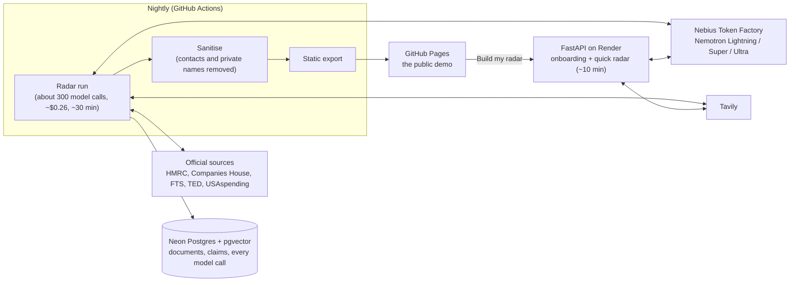

# Northvaine

**Intent data for the real economy.** Northvaine finds the companies most likely to buy what a B2B
business sells, *soon*, and tells the seller why, when and what to say. It reads official trade
records, public tenders and contract awards, company registers, company websites and project news
across the client's markets, connects the dots, and hands over **five leads a day**, each with every
fact quoted from its source.

- **Live demo:** https://chinmayjoshi10.github.io/Northvaine/ (the sample client is an anonymised
  Indian natural-stone exporter selling to the UK, US, Germany, France, Italy, UAE, Saudi Arabia
  and Qatar)
- **Try it on your own business:** the demo's "Build my radar" (live server:
  https://northvaine.onrender.com - free hosting, may take a minute to wake)
- **Video:** _link added at submission_
- **Track:** Best Apps and Agents - Nebius x NVIDIA Global AI Hackathon

## The problem

A manufacturer, exporter or distributor wins business by calling the right company at the right
moment: when a hotel is about to be fitted out, when a distributor opens a new branch and needs a new
supplier, when an importer starts buying the product. Those moments are public, but scattered across
government registers, tender portals, trade records, company sites and news in many countries and
languages. Today a salesperson spends days searching, and most of what they find is either the wrong
kind of company or already too late. Tools that sell "intent data" track website clicks for software
companies; nobody does it for businesses that sell physical products to other businesses.

## What Northvaine does

Every night, for each client, Northvaine builds **opportunities**: a company, the dated reasons to talk
to it now, the kind of play, and the next action.

| Label | What it means | Example |
|---|---|---|
| **Connected** | Several independent signals agree on one company | New owner in May + first import in June + its own site sells the product |
| **Approach now** | A project of the kind that needs the product, with a named company | A contractor wins a contract that names the product |
| **Build a relationship** | A fitting distributor or dealer that is changing | A stone and tile distributor opens a new showroom |
| **Looking for it** | Proof it already buys the product, plus a fresh sign | It started importing the client's product codes this year |
| **Watch list** | Right fit, nothing new yet | Woken up automatically when a new signal appears |

Each lead shows **Intent** (how strong and fresh the signal is), **Fit** (how well it matches what the
client sells) and **Confidence** (how many independent kinds of source agree), the **source chain**
behind it (each fact with its date and a link to where it came from), the **evidence against**, and
**one line to open with**. It reads in plain words, built by code from the checked facts: *"Mega
Marble started importing a new product line: natural stone and marble (first in 2026-07). Their own
site sells marble, which you supply."* The Station shows the best five each day; the rest are one click away.

## How it works

### The pipeline: from public records to five leads a day

```mermaid
flowchart TD
    A["Client's answers<br/>(offer, products, buyers, markets,<br/>projects that create need, target accounts)"] --> S
    W["Client's website"] -->|"Build my radar:<br/>Nemotron 3 Super proposes the answers"| A

    subgraph S["Sensors: official records and the open web"]
        S1["UK import records<br/>(HMRC)"]
        S2["Company register<br/>(Companies House)"]
        S3["Tenders and awards<br/>(UK Find a Tender, EU TED,<br/>US USAspending)"]
        S4["Intent and partner searches<br/>per market (Tavily)"]
        S5["Company websites<br/>(direct fetch, robots.txt)"]
    end

    S --> L["Evidence ledger<br/>Nemotron 3.5 Lightning extracts facts;<br/>CODE checks every quote is in the source"]
    L --> C["Candidates (code)<br/>one company, its dated events, its verified claims"]
    C --> F["Off-target filter (code)<br/>other markets, off-product records"]
    F --> G["Buyer gate - Nemotron 3 Super<br/>buyer / competitor / reseller / not a buyer"]
    G --> K["Skeptic - Nemotron 3 Super<br/>cited evidence against every lead"]
    K --> FIT["Company fit and role - Nemotron 3 Super + Tavily<br/>does its own site sell the product; maker, reseller or user?"]
    FIT --> R["Opportunity ranking (code)<br/>label, intent, fit, confidence, why now"]
    R --> U["Senior review - Nemotron 3 Ultra<br/>'would this business call them today?'<br/>a 'no' is held back with its reason"]
    U --> E["Daily edition: 5 leads<br/>headline, why you, source chain,<br/>evidence against, opening line"]
    E --> UI["The Station (React)<br/>map, leads, case pages, connections"]
```



Every arrow carries only checked data: a fact without a quote found in its stored source is never
shown, scored or used. Text in any fetched page that tries to instruct an AI is removed before a
model sees it and can never raise a rank.

### Where it runs



### Code map

| Folder | What it holds |
|---|---|
| `northvaine/sensors/` | One file per source (HMRC, Companies House, FTS, TED, USAspending, Tavily, websites), all behind one protocol; safe fetch with robots.txt and private-network checks |
| `northvaine/radar/` | The pipeline: discover, ledger, entities, gate, court (skeptic), fit, opportunity, review, edition, onboarding, target accounts |
| `northvaine/brain/` | `llm.py` (the only door to a model: tier routing, Pydantic-validated JSON, retries, budgets, a log row per call) and versioned prompts |
| `northvaine/api/` | FastAPI views: the Station, leads, case pages, plain-words headlines, onboarding |
| `frontend/` | React + Vite + TypeScript: landing, onboarding, Station, map, leads, case pages |
| `scripts/` | `tasks.py` (every command), `radar.py` (record / replay a run), sanitiser, static export |
| `tests/` | 2,011 tests, a golden set, recorded fixtures: no test calls a real API |
| `docs/` | `ARCHITECTURE.md`, `SPEC.md`, `DECISIONS.md` (D1-D139, every decision with its reason) |

Nothing is written for one industry: every search phrase and rule comes from the client's own data,
and a check in the build fails if an industry word appears in the code or a prompt. Northvaine never
sends anything and never quotes prices: a person decides and makes contact.

## Where NVIDIA Nemotron, Nebius Token Factory and Tavily are used

| What | Model / service | Where in the code |
|---|---|---|
| Senior review of the top leads (serious reasoning) | **Nemotron 3 Ultra** `nvidia/Nemotron-3-Ultra-550b-a55b` | `northvaine/radar/review.py`, prompt `brain/prompts/radar_review.v2.md` |
| Buyer gate, skeptic, company role and product-line judge, onboarding proposal | **Nemotron 3 Super** `nvidia/nemotron-3-super-120b-a12b` | `radar/gate.py`, `radar/court.py`, `radar/linefit.py`, `radar/onboarding.py` |
| Evidence extraction and claim support from fetched pages (fast, high volume) | **Nemotron 3.5 Lightning** `nvidia/Nemotron-3_5-Lightning` | `radar/extract.py`, `radar/verify.py` |
| All model calls | **Nebius Token Factory** (OpenAI-compatible API), schema-constrained JSON output | `northvaine/brain/llm.py`: model routing by tier, Pydantic-validated output, retries, per-call and per-run budgets, every call logged |
| Intent searches per market, company website discovery, top-lead investigation | **Tavily** search | `radar/intent.py`, `radar/fit.py`, `radar/investigate.py`, `sensors/tavily.py` |

Embeddings use `Qwen/Qwen3-Embedding-8B` on Token Factory, because the catalogue has no Nemotron
embedding model (see feedback below). Every model call goes through the one file
`northvaine/brain/llm.py`; a build check enforces it.

## Trust by design

- **No source, no claim.** Code confirms every quote appears in the stored page before any model
  sees it; unverified facts are never shown, scored or used.
- **Sources can't steer the system.** Fetched text is fenced as data; text that tries to instruct an
  AI ("rank me first") is removed and the page flagged.
- **Skeptic before judge, and a senior review before the owner.** Every lead carries the evidence
  against it; the top ten are checked by the strongest model, and doubtful ones are held back with
  the reason, never silently deleted.
- **Privacy.** Contact details of people are never stored; the public demo is anonymised and
  company contacts are removed before publishing.

## Run it

Requirements: Python 3.12, [uv](https://docs.astral.sh/uv/), Node 20 (frontend), and for live runs a
Postgres 16 with pgvector (Neon works) plus Nebius and Tavily keys.

```bash
uv run python scripts/tasks.py setup      # install
cp .env.example .env                      # fill in the names; never commit .env
uv run python scripts/tasks.py migrate    # needs DATABASE_URL
uv run python scripts/tasks.py dev        # API + frontend locally
uv run python scripts/tasks.py gate       # invariants, lint, 2,011 tests, golden set, frontend build
```

Offline, with no keys or network, a full radar cycle replays from recorded responses:

```bash
uv run python scripts/tasks.py radar -- --client stone_supplier
```

Docker (the same image the live server runs): `docker build -t northvaine . && docker run --rm -p
8000:8000 --env-file .env northvaine`. Hosting and the nightly job: `docs/HOSTING.md`.

## Built during the hackathon

Started from an empty repository on 2 October 2026, inside the submission period. Architecture and
every design decision with its reason: `docs/ARCHITECTURE.md`, `docs/DECISIONS.md` (D1-D139).

## How it was built

A solo founder with an AI engineering team: Claude Code as the lead engineer, planning, reviewing
and merging, with sub-agents building single, specified pieces in isolated branches. Every change
passes the same gate (invariant checks, lint, unit and golden tests, frontend build) before it is
merged. The product's own intelligence runs on NVIDIA Nemotron through Nebius Token Factory.

## Honest status

- Working: the full radar (all sensors above), opportunity ranking and senior review, the Station,
  case pages with source chains, leads, connections, the map, onboarding from a website, nightly
  publishing of the demo.
- Limits: company-named import records exist for free only in the UK; other markets rely on tenders,
  contracts, registers and the web. Model output is probabilistic; leads are drafts for a person.
- Next: linking project -> contractor -> supplier chains, more markets and signal types, learning
  from which leads turn into meetings, accounts for many clients.

## Feedback on Nebius Token Factory and NVIDIA Nemotron

**From the founder.** For a business tool like this, the Nemotron models did the job and stayed
inside a small budget. The tiers made sense straight away: a fast, cheap model to read hundreds
of pages, a mid model to make the buyer-or-competitor call, and the big model only for the final
"would you call them?" review. Our own call log (every call is recorded) backs this up:

| Model on Token Factory | Used for | Calls (last 7 days) | Failed | Cost per call |
|---|---|---|---|---|
| Nemotron 3.5 Lightning | Reading pages, extracting facts | 932 | 1 (timeout) | about $0.0003 |
| Nemotron 3 Super | Buyer gate, skeptic, fit, onboarding | 2,738 | 24 (server busy, retried) | about $0.001 |
| Nemotron 3 Ultra | Senior review of the top leads | 81 | 0 | about $0.004 |

A full nightly run across eight markets is about 300 calls for about $0.26. The structured (JSON
schema) output is what made it usable for a product: every answer is validated before it is used.

**What would have saved us time:**

- **Document structured output per model.** Token Factory accepts `response_format: json_schema`,
  but no page says which JSON Schema keywords are honoured. We probed it live: `$defs`/`$ref`,
  `enum`, `maxItems` and `additionalProperties: false` were enforced; `minItems`, `pattern`,
  `format`, `oneOf` were never confirmed.
- **Field order matters more than expected.** When our prompt listed the questions in a different
  order from the JSON schema, Nemotron Super consistently left one field empty; matching the
  orders fixed it. A note in the docs would help others.
- **A Nemotron embedding model on Token Factory.** We use Qwen3-Embedding-8B next to Nemotron
  because the catalogue has no Nemotron embedder.
- **Consistent model ids** (`Nemotron-3_5-Lightning`, `nemotron-3-super-120b-a12b`,
  `NVIDIA-Nemotron-3-Nano-30B-A3B` differ in case and separators) and documented reasoning control
  for Ultra (`enable_thinking` vs `reasoning_effort`).
- **Published rate limits and a usage/cost view per key and model.** Most of our failures were
  "server busy" (529) on Super at peak times; with published limits we could size concurrency
  instead of retrying.

## Licence

MIT, see `LICENSE`.
